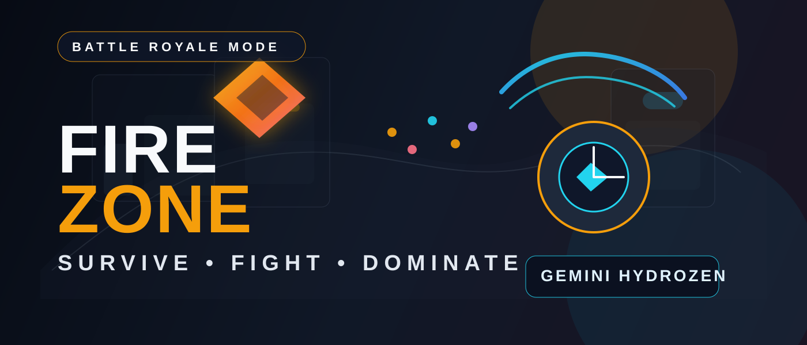

# Fire Zone: Battle Royale

  

A fast-paced browser-based battle royale game inspired by tactical survival shooters. Drop into a hostile zone, loot weapons, manage your health, deploy defensive cover, and outlast the shrinking radiation field.

## Game Overview

Fire Zone: Battle Royale is a top-down survival arena where the player fights against AI-controlled opponents in a hostile map filled with loot, cover, buildings, and a deadly shrinking safe zone. The objective is simple: survive the storm, defeat enemies, and become the final survivor.

## Features

- Solo battle royale gameplay with 18 total survivors
- AI enemy bots with roaming, targeting, and combat behavior
- Procedural map generation with buildings, trees, rocks, and cover elements
- Weapon pickups including rifles, shotguns, sniper rifles, and pistols
- Medkits and Gloo wall deployments for tactical survival
- Armor and health management
- Dynamic shrinking safe zone with radiation damage
- Kill feed and match summary screens
- Mobile-friendly controls and desktop keyboard support

## How to Play

1. Open `fire_zone_battle_royale.html` in a modern web browser.
2. Click the `DROP IN` button on the start screen.
3. Use WASD to move and the mouse or touch controls to aim.
4. Collect loot, manage your inventory, and survive the shrinking zone.
5. Eliminate enemies and win the match.

## Controls

- `WASD` — Move
- `LMB` — Aim and shoot
- `1 / 2 / 3` — Switch weapons
- `R` — Reload
- `H` — Use medkit
- `G` or `RMB` — Deploy Gloo wall
- Use the in-game sound toggle to mute or unmute sound effects

## Weapon Loadout

The game includes a variety of weapons and tactical items:

- G18 Pistol
- AK47 / M4A1 style rifle
- M1887 shotgun
- AWM sniper rifle
- Medkits
- Gloo Walls
- Armor upgrades
- Ammo pickups

## AI Model: Gemini Hydrozen

The project identifies its AI model as **Gemini Hydrozen**. In the game, opponents are browser-based bots with built-in behavior for roaming, combat, and survival. Gemini Hydrozen is the named AI identity associated with the project; the game file does not show an external Gemini API integration.

## Project Files

- `fire_zone_battle_royale.html` — Main game file containing the gameplay, interface, and game logic
- `assets/fire-zone-banner.svg` — Custom README banner artwork

## Run Locally

No build step is required. Clone or download the repository, then open `fire_zone_battle_royale.html` in a modern web browser. The page loads Tailwind CSS and fonts from CDNs, so those styling resources require an internet connection.

## License

No license file is currently included in this repository. Please contact the repository owner for permission before redistributing or reusing the project.

---

**Fight • Survive • Dominate** — One battlefield. One champion.
